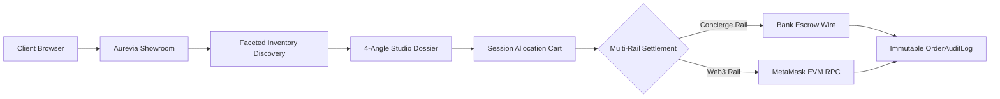

# Aurevia Motors — Luxury Supercar Atelier & Digital Showroom

<div align="center">

[](https://aurevia-motors.onrender.com/)
[](https://www.python.org/)
[](https://www.djangoproject.com/)
[](https://metamask.io/)
[](https://github.com/poshiyaharsh/aurevia-motors)

**A high-performance digital atelier and acquisition platform engineered for sovereign collectors of rare hypercars, track specials, and bespoke grand tourers.**

[Explore Live Showroom](https://aurevia-motors.onrender.com/) • [Browse Supercar Catalog](https://aurevia-motors.onrender.com/catalog/) • [Heritage Marques](https://aurevia-motors.onrender.com/catalog/marques/) • [System Health](https://aurevia-motors.onrender.com/health/)

</div>

---

## 🌐 Live Web Experience

The production showroom is live and fully interactive:

* **Digital Showroom**: [https://aurevia-motors.onrender.com/](https://aurevia-motors.onrender.com/)
* **Hypercar Inventory**: [https://aurevia-motors.onrender.com/catalog/](https://aurevia-motors.onrender.com/catalog/)
* **Marque Collections**: [https://aurevia-motors.onrender.com/catalog/marques/](https://aurevia-motors.onrender.com/catalog/marques/)
* **Platform Health Diagnostic**: [https://aurevia-motors.onrender.com/health/](https://aurevia-motors.onrender.com/health/)
* **Administrator Portal**: [https://aurevia-motors.onrender.com/admin/](https://aurevia-motors.onrender.com/admin/)

> **Demo Staff Credentials**:
> * **Username**: `admin`
> * **Password**: `AureviaAdmin2026!`

---

## 🏎️ The Curated Collection

Aurevia Motors features six legendary automotive marques representing internal combustion perfection, atmospheric hybrids, and high-performance electric architectures:

| Marque | Origin | Engineering Hallmarks | Flagship Allocations |
|:---|:---|:---|:---|
| **Bugatti** | Molsheim, France | Quad-turbo W16, Cosworth V16 atmospheric hybrid, 300+ mph aero | *Tourbillon V16, Chiron Super Sport 300+, W16 Mistral, Bolide Track Hypersport* |
| **Ferrari** | Maranello, Italy | Formula 1 kinetic hybrid tech, twin-turbo V8, naturally aspirated V12 | *SF90 XX Stradale, 812 Competizione, Daytona SP3, 296 GTB Assetto Fiorano* |
| **Lamborghini** | Sant'Agata Bolognese, Italy | Naturally aspirated V12 HPEV, extreme ALA active aero, rev-limit V10 | *Revuelto V12 Hybrid, Countach LPI 800-4, Huracán Sterrato, Sián FKP 37* |
| **McLaren** | Woking, United Kingdom | Carbon fiber Monocage, twin-turbo V8, active DRS aero | *Speedtail Hyper-GT, Senna Track Series, P1 GTR Track Weapon, 750S Spider* |
| **Porsche** | Stuttgart, Germany | High-revving atmospheric flat-six, Weissach weight reduction, hybrid icons | *918 Spyder Weissach, 911 GT3 RS (992), Carrera GT V10, 911 S/T 60th Anniversary* |
| **Rolls-Royce** | Goodwood, United Kingdom | Twin-turbo V12 waftability, Architecture of Luxury, all-electric quietude | *Phantom VIII Series II Extended, Spectre All-Electric, Ghost Black Badge, Cullinan Black Badge* |

---

## 💎 Platform Capabilities & Highlights



### 1. Artisanal Showroom & Faceted Discovery
* **Multi-Attribute Filters**: Real-time filtering across marque, horsepower rating, propulsion architecture (petrol, atmospheric hybrid, all-electric), transmission type, and valuation brackets.
* **Dynamic Stock Counters**: Live matching counters update with zero page reloads.
* **Visual Allocation States**: Color-coded badges indicating allocation states (`Available in Atelier`, `Allocation Reserved`, `Acquired / Sold`).

### 2. Technical Dossiers & Multi-Angle Studio Media
* **High-Fidelity Visuals**: 1200×800 studio photography processed through Lanczos resampling and bespoke 24K gold watermark rendering.
* **4-Angle Perspectives**:
  * 📸 *Hero Studio Stance*
  * 🏎️ *Cockpit & Bespoke Controls*
  * 💨 *Rear Aerodynamic Profile*
  * 🏁 *Track Stance & Chassis Detail*
* **Mechanical Dossiers**: Official VIN tracking, powertrain layout, electric motor topology, brake rotors, and suspension kinematics.

### 3. Allocation Session Cart & Pricing Engine
* **Server-Authoritative Validation**: All cart allocations and boundary conditions are validated server-side.
* **Luxury Tax & Surcharge Computation**: Precise Decimal math computes base cost, configurable luxury duty, and final balance.
* **VIP Voucher Engine**: Dynamic coupon verification for percentage discounts and fixed atelier credits with minimum spend thresholds.

### 4. Dual-Rail Settlement Architecture
* **Concierge Bank Escrow**: Dedicated IBAN/SWIFT instruction generators with anti-tamper wire reference tracking and operator verification.
* **Cryptographic Web3 / MetaMask Rail**:
  * Direct browser wallet integration via EIP-1193.
  * Automatic transaction payload preparation targeting verified recipient contracts.
  * Server-side cryptographic receipt validation via Ethereum JSON-RPC.
  * Anti-replay defense enforcing unique transaction hashes and sender wallet verification.

### 5. Client Portfolio & Order History
* **Private Collector Profiles**: Secure authentication, personal credentials, and multi-address book management for enclosed white-glove transport delivery.
* **Order Lifecycle Progression**: Status updates from `Pending Escrow` to `Payment Confirmed`, `Atelier Processing`, and `Delivered`.
* **Printable Invoices**: Archival, printable order dossiers documenting allocated VINs, price breakdowns, and settlement proofs.

### 6. Operational Governance & Anti-Tamper Audit Trail
* **Staff Admin Interface**: Complete administrative interface for marques, vehicles, specifications, coupons, and orders.
* **Immutable Audit Trail**: Dedicated `OrderAuditLog` tracks every state mutation with operator identification, timestamp, and notes.

---

## 🏛️ System Architecture

```
aurevia-motors/
├── apps/
│   ├── core/         # Showroom landing, system health diagnostics, custom 404/500 handlers
│   ├── catalog/      # Marques, hypercars, 4-angle media galleries, technical specifications
│   ├── accounts/     # Client profiles, delivery address book, authentication & admin seeding
│   ├── cart/         # Server-authoritative session cart & inventory allocation constraints
│   └── orders/       # Order lifecycle state machine, pricing engine, escrow & Web3 settlement
├── config/
│   ├── settings/     # Modular profiles (base, development, production)
│   ├── urls.py       # Global URL routing & media asset dispatching
│   ├── wsgi.py       # WSGI entry point
│   └── asgi.py       # ASGI entry point
├── media/
│   └── vehicles/     # Curated 96 high-resolution hypercar photographs
├── static/
│   ├── css/style.css # Dark atelier design system with 24K gold accents
│   └── js/main.js    # Gallery switcher, modal controllers, MetaMask Web3 client
└── templates/        # Semantic, accessible HTML5 templates
```

---

## 🛠️ Technology Stack

| Layer | Technologies |
|:---|:---|
| **Backend Framework** | Python 3.12, Django 5.1 |
| **Static & Media Pipeline** | WhiteNoise (Brotli/Gzip), Pillow (Lanczos image resampling) |
| **Settlement Rails** | Concierge Bank Escrow, Web3 (MetaMask, EIP-1193, Ethereum JSON-RPC) |
| **Database** | Relational integrity via Django ORM (PostgreSQL ready / SQLite) |
| **Frontend & UI** | Vanilla HTML5, CSS3 Custom Properties, Responsive Mobile Navigation Drawer |
| **Design Language** | Dark Atelier Palette (`#0A0C10` background, `#D4AF37` 24K gold accents, WCAG AA compliant) |
| **Quality & Assurance** | 132 automated unit and integration tests |

---

## 🔒 Security Posture

* **Server-Authoritative Integrity**: All financial arithmetic, discount logic, and tax valuations are computed strictly on the server.
* **CSRF & Session Hardening**: Strictly enforced CSRF tokens on all POST/mutating endpoints, HTTP-only secure cookie flags, and session boundary isolation.
* **Safe Redirect Guardrails**: Strict `url_has_allowed_host_and_scheme` validation guarding against open-redirect attacks.
* **Security Headers**: Strict clickjacking defense (`X-Frame-Options: DENY`), MIME-sniffing prevention (`X-Content-Type-Options: nosniff`), and HSTS policy enforcement.

---

## 📜 Provenance & License

Aurevia Motors is a premier demonstration platform developed to showcase enterprise-grade full-stack Python/Django architecture, digital asset curation, and hybrid Web2/Web3 financial workflows.
